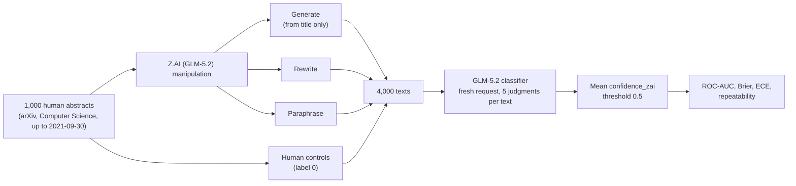

# Black-Box Detection of Z.AI-Generated and Modified Academic Abstracts Against Human-Written Controls

Replication package for the paper **"Black-Box Detection of Z.AI-Generated and Modified Academic Abstracts Against Human-Written Controls: Discrimination, Calibration, and Repeatability of GLM-5.2 Verbalized Confidence"** (Sir & Tallo, *Jurnal ELTIKOM*, 2026).


<!-- After the first Zenodo release is synced, add: [](https://doi.org/[FILL IN: Zenodo concept DOI]) -->

GLM-5.2 (Z.AI) is queried as a black box with a fixed prompt and asked to decide whether an academic abstract is human-written (`non-Z.AI`) or generated or modified by Z.AI (`Z.AI`). It also reports a verbalized confidence for each decision. This repository holds the data, prompts and released outputs used to evaluate three things:

1. **Discrimination:** how well GLM-5.2 separates human abstracts from Z.AI-generated, rewritten and paraphrased variants.
2. **Probabilistic quality and calibration:** whether its verbalized confidence is a usable probability (Brier Score, ECE).
3. **Repeatability:** how consistent its five judgments of the same text are.

> **Responsible use.** The scores are decision-support evidence for preliminary screening only. They are not proof of authorship and must not be the sole basis for an academic-integrity decision. See [Ethics and responsible use](#ethics-and-responsible-use).

## Contents

- [Key results](#key-results)
- [Experimental design](#experimental-design)
- [Repository structure](#repository-structure)
- [Data](#data)
- [Getting started](#getting-started)
- [Reproducibility notes](#reproducibility-notes)
- [Known limitations](#known-limitations)
- [Ethics and responsible use](#ethics-and-responsible-use)
- [License](#license)
- [How to cite](#how-to-cite)
- [Contact](#contact)

## Key results

Each condition is compared against the same 1,000 human-written controls. The Z.AI-class score is the mean of five within-response judgments, and the decision threshold is 0.5. 95% CIs are percentile intervals from 10,000 source-family bootstrap replicates.

| Condition | Accuracy (95% CI) | F1 (AI class) | ROC-AUC (95% CI) | Brier Score (95% CI) | ECE, 10 bins (95% CI) | False-negative rate |
|---|---|---|---|---|---|---|
| Generate | 97.55% (96.85–98.20) | 97.58% | 0.9952 (0.9926–0.9973) | 0.0354 (0.0319–0.0390) | 0.1019 (0.0955–0.1087) | 1.30% |
| Rewrite | 89.10% (87.80–90.35) | 88.24% | 0.9472 (0.9372–0.9566) | 0.0920 (0.0850–0.0993) | 0.0781 (0.0685–0.0904) | 18.20% |
| Paraphrase | 85.60% (84.20–87.00) | 83.86% | 0.9266 (0.9155–0.9372) | 0.1147 (0.1066–0.1230) | 0.0828 (0.0742–0.0948) | 25.20% |

The false-positive rate on the human controls is 3.60% (36/1,000), identical in all three scenarios because the same controls are reused.

- **Detection depends on the manipulation.** Accuracy differs across the three scenarios (Cochran's Q = 248.17, df = 2, p < 0.005), and all pairwise McNemar tests with Holm correction are significant.
- **Best discrimination is not best calibration.** Generate has the highest ROC-AUC and the lowest Brier Score, but also the highest ECE. The Rewrite and Paraphrase ECE ordering changes across 5, 10, 15 and 20 bins, while Generate has the highest ECE under all four.
- **Repeatability differs by condition.** Five-way label agreement (5:0) is 98.20% for Generate, 92.60% for Rewrite, 90.10% for Paraphrase and 95.90% for human controls.
- **Agreement is not correctness.** 88.10% of missed Paraphrase texts (222/252) and 66.67% of false-positive controls (24/36) received the same wrong label in all five judgments.

The full statistical results, including the paired ΔECE tests and test statistics, are in the paper and in the release notes of each [GitHub Release](../../releases).

## Experimental design



GLM-5.2 applies three manipulations to every source abstract. The prompts are in `Prompt_engineering/`.

| Condition | What was done | Input to Z.AI |
|---|---|---|
| **Generate** | A new abstract written from the paper title only (maximum 300 words). | Title |
| **Rewrite** | Complete rewrite in a new linguistic style while keeping all numbers, metrics and facts; clichéd AI phrasing to be avoided. | Source abstract |
| **Paraphrase** | Copy-editing style paraphrase that changes wording and sentence structure while keeping technical content. | Source abstract |

Not tested: summarization, translation, character- or token-level perturbation, third-party "humanizer" tools, cascaded or repeated manipulations, and text from any LLM other than GLM-5.2.

## Repository structure

```text
Zhipu_AI_Self-Detector/
├── dataset/
│   ├── tbl_transformations.xlsx      # 4,000 texts: 1,000 controls + 3,000 Z.AI variants
│   ├── evaluation_result.xlsx        # 20,000 judgments (4,000 texts x 5)
│   └── classification_result.xlsx    # 4,000 texts aggregated from the 20,000 judgments
├── Prompt_engineering/               # prompts for Generate, Rewrite and Paraphrase
├── self-detection_prompt.txt         # verbatim classification prompt used in the experiment
├── LICENSE                           # code license (MIT)
└── LICENSE-DATA                      # data license
```

**[FILL IN: add any scripts, notebooks or `requirements.txt` that are in the repository and remove lines that do not match the actual layout.]**

## Data

| Item | Value |
|---|---|
| Source corpus | *arXiv Paper Abstracts* (Paul & Rakshit, Kaggle) |
| Eligibility | English, Computer Science, archived on or before September 30, 2021 (54,230 eligible abstracts) |
| Selection | First 1,000 complete source families in dataset order. There is no random sampling, so no sampling seed. 152 sources were excluded for failed transformation or classification validation and replaced by the next record |
| N (source abstracts) | 1,000 |
| K (manipulation types) | 3 (Generate, Rewrite, Paraphrase) |
| Texts | 4,000 = 1,000 human controls + 3 × 1,000 Z.AI variants |
| R (repeats) | 5 judgments per text, produced within one API response (not five separate calls) |
| Judgment-level outputs | 20,000 (4,000 requests × 5) |

**Labels.** Binary: `non-Z.AI` (human control, 0) and `Z.AI` (generated or modified, 1; the positive class).

**Judgment format.** Each judgment is JSON with `run`, `prediction`, `confidence_non-zai`, `confidence_zai` (four decimals, summing to 1.000 ± 0.001) and `reason`. `text_id` groups the five judgments of one text, and `source_id` links a control to its three variants.

## Getting started

```bash
git clone https://github.com/Tinceetlin/Zhipu_AI_Self-Detector.git
cd Zhipu_AI_Self-Detector
python -m venv .venv && source .venv/bin/activate
pip install pandas openpyxl
python - <<'EOF'
import pandas as pd
for f, n in [("dataset/tbl_transformations.xlsx", 4000), ("dataset/evaluation_result.xlsx", 20000), ("dataset/classification_result.xlsx", 4000)]:
    df = pd.read_excel(f); print(f, df.shape, "OK" if len(df) == n else "MISMATCH", list(df.columns))
EOF
```

This checks the file sizes stated above (4,000, 20,000 and 4,000 rows) and prints the column names.

**[FILL IN: add one command that recomputes the paper's metrics (Table 4) once the metric script is in the repository.]**

## Reproducibility notes

| Item | Value |
|---|---|
| Model / endpoint | `glm-5.2` via `https://api.z.ai/api/paas/v4/chat/completions` |
| Collection window | All transformation and classification calls were made between **July 22 and August 16, 2026**. No immutable model snapshot or build identifier was recorded |
| Parameters | temperature 0.0; thinking type enabled; reasoning_effort max |
| Context isolation | Each abstract in a fresh request: current prompt plus abstract only, no history |
| Aggregation | Per-text mean of the five `confidence_zai` values; decision threshold 0.5 (≥ 0.5 means Z.AI) |
| Statistics | 10,000 source-family bootstrap replicates; 10,000 paired randomization replicates for ECE differences; Holm correction; Cochran's Q, McNemar (Yates), Friedman |
| Python version | **[FILL IN: output of `python --version`]** |
| Z.AI SDK or HTTP client and version | **[FILL IN: the paper reports only the REST endpoint]** |
| Bootstrap / randomization seed | **[FILL IN from code, or state "not set"]** |

GLM-5.2 is a hosted commercial model, so re-running the API calls may not reproduce the released outputs exactly. The released spreadsheets are the reference data for the paper's numbers.

## Known limitations

- **One model only.** Only GLM-5.2 (Z.AI) was evaluated, and the results do not transfer to other models.
- **Black-box protocol.** Only labels and verbalized confidence were used; no logits, weights or hidden activations. The results are not evidence of an internal self-recognition mechanism.
- **Snapshot may change.** The hosted API can change, and no immutable snapshot ID was recorded.
- **Human-only negatives.** The negative class has no outputs from other LLMs, so Z.AI-specific recognition cannot be separated from sensitivity to generic LLM cues.
- **Scope.** English Computer Science abstracts, one prompt and one API configuration. Prompt wording and API settings were not varied.
- **Limited repeatability window.** The five judgments come from a single response, so they do not show long-term stability.
- **Selection and reuse.** 152 sources were excluded for processing failures (possible selection effect, not quantified). The same 1,000 controls appear in all three scenarios, and the 2021 cutoff does not rule out overlap with the model's training data.
- **No same-data baseline.** No other detector or LLM judge was run on these 4,000 texts.

## Ethics and responsible use

- **Not proof of authorship.** On human-written abstracts the false-positive rate was 3.60%, and the Paraphrase condition missed 25.20% of Z.AI-modified texts.
- **What is released.** Study data, prompts and statistical outputs for replication. No trained classifier, model weights or ready-to-use detection application.
- **Dual-use materials.** The Rewrite and Paraphrase prompts were written to alter wording and style. They are released to document the experiment and must not be used to disguise AI involvement where disclosure is required.
- **Data.** Human abstracts come from a public arXiv-derived dataset, and no private or personal data were collected.
- **AI assistance.** The authors report using ChatGPT for literature-candidate identification, reference checking, language editing and paraphrasing of manuscript text, and take responsibility for the content.

## License

| Component | License |
|---|---|
| Code and scripts | MIT (see `LICENSE`) |
| Dataset (`dataset/`) | **[DECIDE: CC-BY-4.0 or CC-BY-NC-4.0 (see `LICENSE-DATA`); confirm the terms of the Kaggle source dataset and the Z.AI output terms first]** |

## How to cite

Cite the paper once it is published; until then, cite the archived release.

```bibtex
@article{sir2026blackbox,
  title     = {Black-Box Detection of {Z.AI}-Generated and Modified Academic Abstracts Against Human-Written Controls: Discrimination, Calibration, and Repeatability of {GLM-5.2} Verbalized Confidence},
  author    = {Sir, Yosua Alberth and Tallo, Tince Etlin},
  journal   = {Jurnal ELTIKOM: Jurnal Teknik Elektro, Teknologi Informasi dan Komputer},
  volume    = {FILL IN},
  number    = {FILL IN},
  pages     = {FILL IN},
  year      = {2026},
  publisher = {P3M Politeknik Negeri Banjarmasin},
  issn      = {2598-3288},
  doi       = {FILL IN}
}

@software{sir2026zhipu_self_detector,
  title     = {Zhipu\_AI\_Self-Detector: Replication package for black-box detection of {Z.AI}-generated and modified academic abstracts},
  author    = {Sir, Yosua Alberth and Tallo, Tince Etlin},
  year      = {2026},
  version   = {v1.0.0},
  publisher = {Zenodo},
  doi       = {FILL IN},
  url       = {https://github.com/Tinceetlin/Zhipu_AI_Self-Detector}
}
```

## Contact

Corresponding author: Yosua Alberth Sir, Department of Information Technology Education, Universitas Nusa Cendana, Kupang, Indonesia (yosuasir@staf.undana.ac.id).

Co-author: Tince Etlin Tallo, Department of Computer Science, Universitas Nusa Cendana, Kupang, Indonesia (tince.tallo@staf.undana.ac.id).
